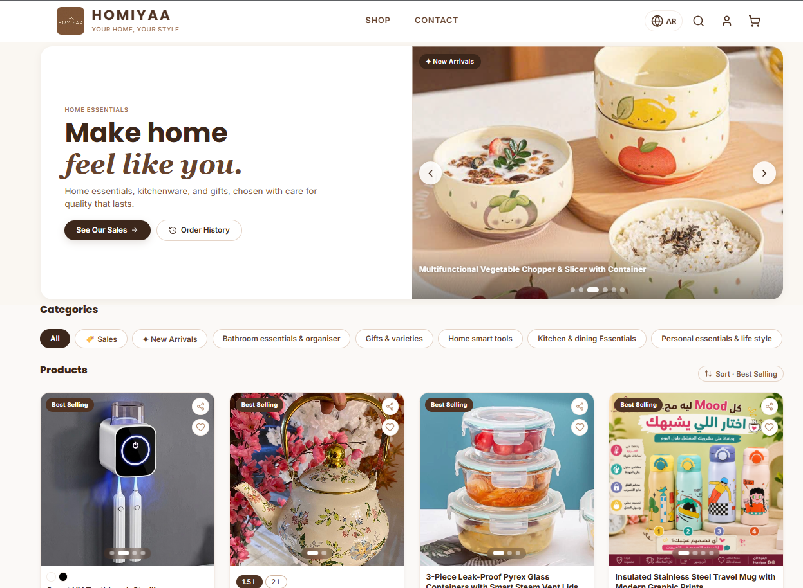
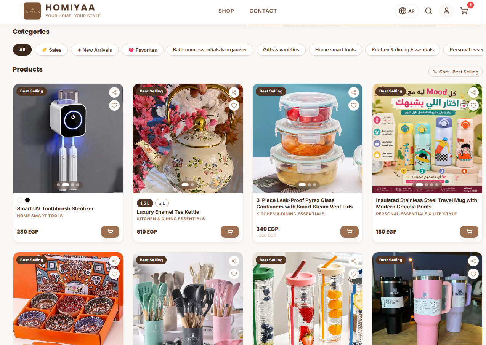
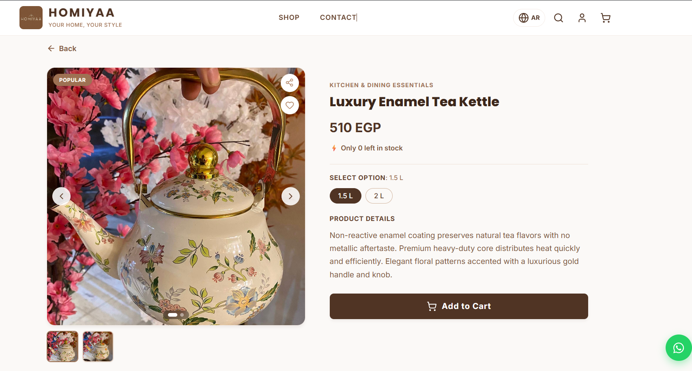
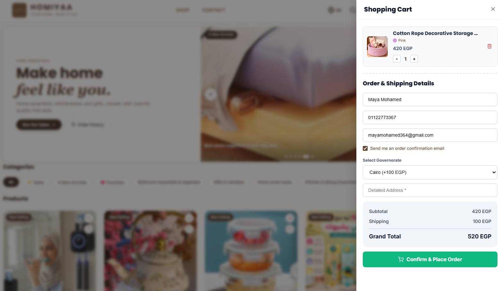
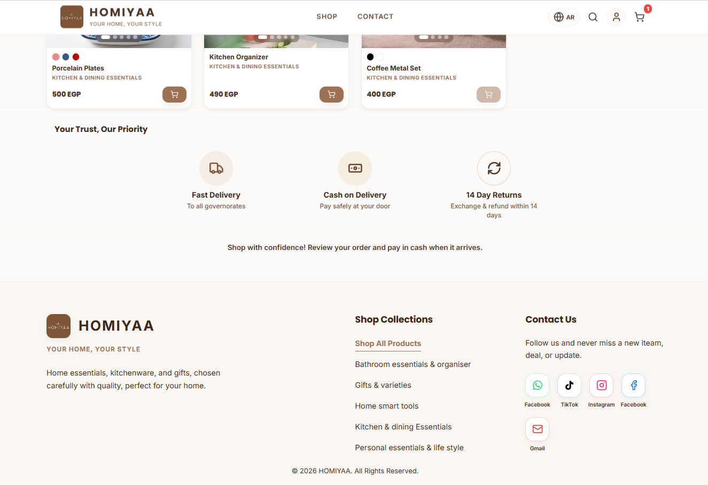
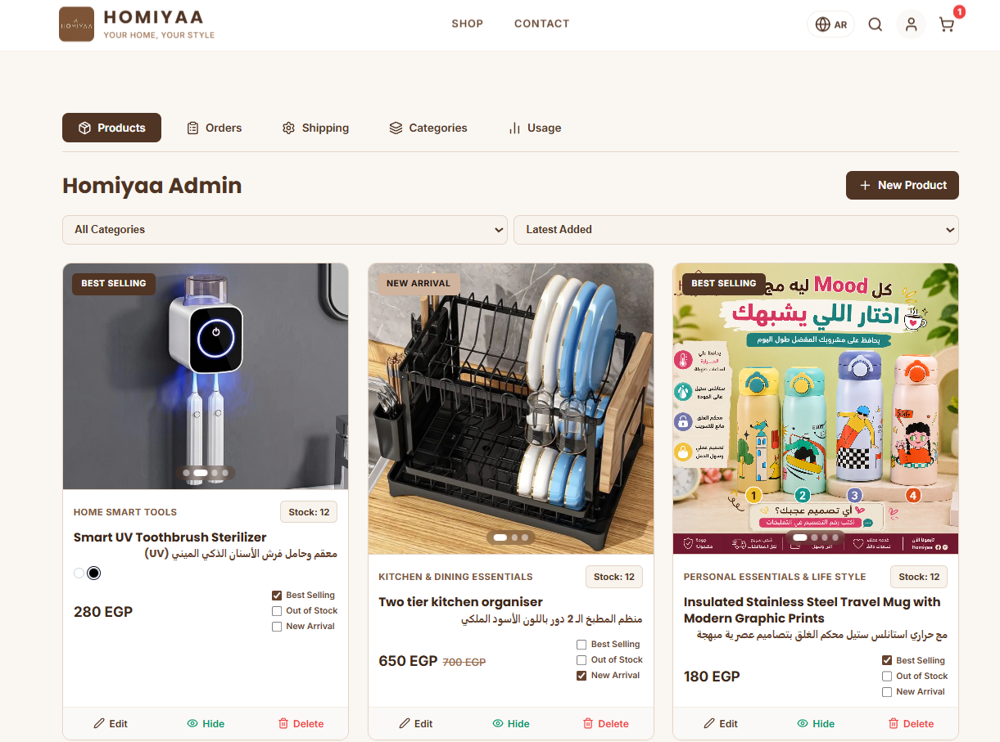

# Homiyaa Store

Homiyaa is an online store I built for a client from scratch, working alone on everything: the design, the frontend, the database, authentication, emails, and deployment. Customers can browse products, add them to a cart, place an order, and watch its status change live. The owner runs the whole shop from an admin dashboard.

**Live site:** [https://www.homiyaa.store/]

  
  

## What it does

### Customers
- Create an account and log in (Supabase authentication)
- Browse products by category and open a product page
- Add items to the cart and place an order
- Follow the order in real time. When the owner changes the status, the customer sees it without refreshing the page
- Get an order confirmation email automatically
- Pages like account and orders are protected, so only logged-in users can open them

### Owner (admin dashboard)
Only the admin account can open the dashboard. From there the owner can:
- Add, edit, and remove products
- Manage categories
- Set up shipping
- Update order status, which customers then see live

## How I built it

| Part | What I used |
|---|---|
| Frontend | React with TypeScript |
| Styling | CSS3, with Framer Motion for animations |
| Backend and database | Supabase (Postgres,SQL, authentication, real-time updates) |
| Emails | EmailJS, for order confirmations |

A few decisions worth explaining:

- **Supabase instead of a custom backend.** The project needed login, a database, and live updates, and Supabase covers all three.
- **Real-time tracking** uses Supabase's real-time subscriptions. The order page listens for changes, so the status updates the moment the admin changes it.
- **Protected routes.** The app checks the user's session before it shows account pages, and checks the admin role before it shows the dashboard.
- **Search setup.** I added a sitemap and `robots.txt` and verified the site with Google Search Console so the store can be found on Google.
